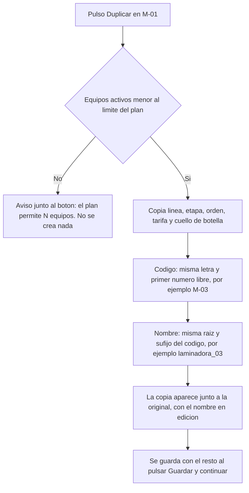
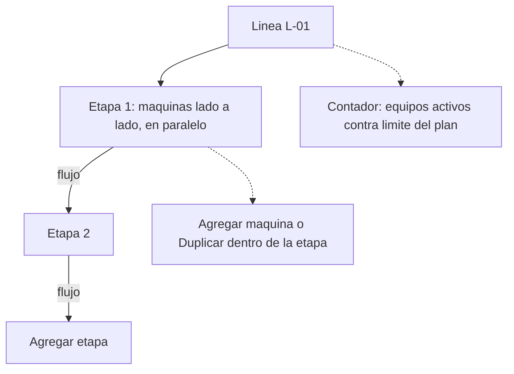

# Auditoría de producción (owner)

Guía para que el owner revise, como usuario final, lo que Kekas publicó en
DigitalOcean. Estado tomado de `main` (`70e360c`) el 2026-10-12.

## Resumen al cierre del 2026-10-12

- **24 hallazgos** y 2 mejoras propuestas. El recorrido quedó detenido en la suscripción.
- **Crítico (17):** la tabla `planes` de producción está vacía; nadie puede obtener piloto ni contratar, y sin plan no se pueden reportar paros.
- **Altos (10 y 20):** el enlace de confirmación llega "ya usado" con correo institucional, y el Mapa de Líneas ignora el orden de etapa capturado.
- **Funciona:** alta de empresa, configuración de planta, archivado de equipos, invitaciones de equipo (Operaciones y Dirección), tableros por rol y todos los permisos y candados probados por API.
- **Sin probar por falta de plan:** paros, costos, cascada, reportes, IA, WhatsApp, mejora de plan y cancelación.

## Dónde está cada cosa

| Qué | Dónde |
| :--- | :--- |
| Aplicación en producción | https://downtimeos.tech (también responde https://app.downtimeos.tech) |
| Iniciar sesión | https://downtimeos.tech/acceso |
| Panel de administración | https://downtimeos.tech/administracion/acceso |
| Servidor | Droplet Ubuntu de DigitalOcean, 1 vCPU / 2 GB, IP `165.227.53.165` |
| Base de datos, Auth y archivos | Proyecto de Supabase de producción (panel en supabase.com) |
| Correo | Resend, remitente de `downtimeos.tech` |
| Código en producción | Rama `main`; la imagen desplegada es del commit `01fb639` |
| Estado escrito por Kekas | `DEPLOY-DIGITALOCEAN.md` y `docs/BACKLOG.md` (HIST-14) |

Producción usa la base real. Todo lo que se registre aquí se queda: usar solo
empresas y datos de prueba, con nombres que se reconozcan (p. ej. "QA Helio").

## Qué pedirle a Kekas antes de empezar

1. Correo y contraseña del **perfil ya creado** con el que dijo que entraras, y
   qué rol y empresa tiene.
2. Correo y contraseña del **panel de administración** (están en un archivo del
   servidor que solo él puede leer). Que los pase por un canal seguro, no por chat.
3. Si en producción están encendidos **WhatsApp** y la **IA**. Si WhatsApp está
   encendido, reportar un paro manda mensajes reales; si la IA está encendida,
   abrir el tablero de Dirección con plan Pro gasta créditos.
4. Acceso de owner al proyecto de **Supabase** y a la cuenta de **Resend**.

## Comprobación automática (ya ejecutada el 2026-10-12)

- `npm test` en `main`: 518 de 518.
- Desde fuera: página principal, acceso, registro, recuperación y suscripción
  responden 200 por HTTPS; `/api/planta` y el panel de administración rechazan
  a quien no ha iniciado sesión (401); HTTP redirige a HTTPS; los puertos de la
  app, Postgres y Supabase Local no están expuestos.
- La primera carga de la página principal tardó 7.7 s; las siguientes, menos de
  1 s. Revisar si se repite.

Para repetirla (solo lectura; el aviso de "no indexado" que falla es propio de
un staging y no aplica a producción):

```bash
node scripts/staging-check.mjs https://downtimeos.tech
```

## Recorrido de usuario final

Marcar cada paso con ✅ funciona, ⚠️ funciona con detalle, ❌ falla. Anotar
pantalla, rol y qué se esperaba.

### A. Entrada con el perfil existente
- [ ] Iniciar sesión en `/acceso` con el perfil de Kekas.
- [ ] La app lleva al tablero que corresponde al rol, sin pantallas intermedias.
- [ ] Cerrar sesión y volver a entrar.
- [ ] "Olvidé mi contraseña": llega el correo real, en español y con la marca.

### B. Alta de una empresa nueva (como cliente)
- [ ] Registrar "QA Helio" en `/registro` con un correo propio.
- [ ] Llega el correo de confirmación a la bandeja real (no a spam).
- [ ] El enlace lleva directo al asistente de configuración de planta.
- [ ] Crear líneas y equipos; guardar tarifas y comprobar que se conservan.
- [ ] Sin plan activo, la app explica qué falta en lugar de fallar.

### C. Suscripción y panel de administración
- [ ] En "Planes y pagos", solicitar **Starter** semestral.
- [ ] Adjuntar un comprobante (PDF o imagen de prueba).
- [ ] Entrar a `/administracion/suscripciones`: aparece la solicitud con su comprobante.
- [ ] "Confirmar pago externo y activar": el plan queda activo para la empresa.
- [ ] Con Starter: el sexto equipo se rechaza y no hay IA ni PDF mensual.
- [ ] **Cambio a mitad del ciclo:** elegir Pro; el formulario cambia a "Mejorar
      plan ahora" y avisa que no hay prorrateo.
- [ ] Activar la mejora en el panel: Pro queda activo al instante y Starter
      aparece como "Reemplazada por mejora de plan" en el historial.

### D. Equipo y roles
- [x] ✅ 2026-10-12 · Invitados Operaciones y Dirección a dos correos de Gmail
      del owner (faltan Finanzas y Operador).
- [x] ✅ 2026-10-12 · Los dos correos llegaron, el enlace de invitación abrió
      bien a la primera y cada cuenta entró a su página; en `/equipo` ambas
      aparecen "Activa". Cubre el pendiente de Kekas "aceptación funcional de
      invitación de equipo". Nota: en Gmail el enlace no falló, a diferencia del
      correo `@tec.mx` del hallazgo 10.
- [ ] El Operador no ve dinero en ninguna pantalla.

### E. Operación (solo si WhatsApp está apagado o Kekas lo autoriza)
- [ ] Operador reporta un paro: Línea → Máquina → Estado.
- [ ] Operaciones lo ve en la bandeja y en el mapa (rojo si cae la etapa
      completa; gris "A la espera" lo de aguas abajo).
- [ ] Operaciones valida; el Operador cierra el paro; el cronómetro cuenta
      desde el reporte.
- [ ] Dirección ve el costo del paro y el Pareto de causas.
- [ ] Rechazar una solicitud devuelve la máquina a operación, sin costo.

### F. Reportes y datos
- [ ] Exportar la bitácora a CSV desde Dirección. (La app exporta CSV; no tiene
      carga de CSV.)
- [ ] Con Pro: PDF mensual y análisis con IA (gasta créditos; una sola vez).

### G. Cierre
- [ ] Solicitar la cancelación del plan: queda programada al fin del periodo y
      el acceso sigue.
- [ ] Pedir a Kekas que retire la empresa "QA Helio" o dejarla marcada como prueba.

## Lo que Kekas reporta como pendiente

Tomado de `docs/BACKLOG.md` en `main`; conviene preguntarle fecha para cada uno:

- Respaldo de la base y prueba de restauración.
- Rotar la llave heredada de Supabase (HIST-11; ninguna llave se ha rotado).
- Confirmar que los correos de Auth llegan a una bandeja real.
- Verificar los secretos y la protección del entorno `production` en GitHub.
- Revisar el firewall del panel de DigitalOcean (hoy no hay ninguno asignado;
  solo el del propio servidor).
- Ensayar la vuelta atrás de un despliegue.
- Activar la protección de contraseñas filtradas en Auth.
- Aceptación funcional de la invitación de equipo.

## Hallazgos de la auditoría

| # | Fecha | Pantalla / rol | Qué pasó | Qué se esperaba | Gravedad | Estado |
| :- | :--- | :--- | :--- | :--- | :--- | :--- |
| 1 | 2026-10-12 | Página principal, sin sesión | Primera carga en 7.7 s | Menos de 2 s. No se repitió: cinco cargas seguidas tardaron entre 0.44 y 0.49 s; fue un arranque en frío | Baja | No reproducido |
| 2 | 2026-10-12 | `/acceso` con credenciales de administrador | "Correo o contraseña incorrectos", sin pista de que el panel interno entra por `/administracion/acceso` | Un aviso o enlace a la otra entrada | Baja | Abierto |
| 3 | 2026-10-12 | `/administracion` · Interruptores | IA, WhatsApp y PDF aparecen "TODO ACTIVO" en producción | Confirmar con Kekas que es intencional: un paro de prueba puede mandar WhatsApp reales y abrir Dirección con Pro gasta créditos | Media | Confirmar con Kekas |
| 4 | 2026-10-12 | `/administracion` · Métricas y prospectos | Producción muestra historial anterior al lanzamiento (447 análisis de IA desde el 25-sep, 83 PDF, 236 WhatsApp) y 30 prospectos con aspecto de datos de demostración | Producción con datos propios, o los de prueba identificados y separados | Media | Confirmar con Kekas |
| 5 | 2026-10-12 | `/administracion` · WhatsApp | 52 de 236 intentos fallidos; tasa de entrega 64 % (último intento el 29-sep) | Saber la causa antes de depender de WhatsApp | Media | Abierto |
| 6 | 2026-10-12 | `/administracion` · Infraestructura | Dice "Entorno: local", "Servicio: DowntimeOS Landing API" y "Región: —" | "producción" y el nombre real del servicio. Es solo la etiqueta (`api/health.js` lee una variable de Vercel); el servidor sí corre en modo producción | Baja | Abierto |
| 7 | 2026-10-12 | `/administracion` · Infraestructura | Latencia a la base: 449 ms | Menos de ~150 ms; revisar si la región de Supabase queda lejos del Droplet | Baja | Por confirmar |
| 9 | 2026-10-12 | Supabase de producción (`orinpbsesgckbvmwjjfl`) | 4 empresas y 2 usuarios, todos de prueba: "Histórico DowntimeOS" y "Auditor Login munmdltt" sin titular, "Diantrack" (hello@…) y "Diabtrack" (Kekas, 11-oct). Ninguna suscripción | Decidir qué empresas de prueba se quedan antes de invitar clientes | Baja | Confirmar con Kekas |
| 10 | 2026-10-12 | Correo de confirmación → `/activar` (alta de empresa nueva) | El correo llegó, pero al pulsar el botón salió "Revisa tu enlace: este enlace expiró o ya se utilizó". La cuenta sí quedó confirmada y se pudo iniciar sesión a mano | Que el enlace lleve directo al asistente de planta. Causa probable: el enlace es de un solo uso (`{{ .ConfirmationURL }}`) y lo consume antes el filtro de seguridad o la vista previa del correo; por confirmar en los registros de Auth. **Datos de la prueba:** cuenta institucional `@tec.mx` (correo corporativo/universitario, de los que suelen revisar los enlaces automáticamente), correo abierto en el navegador y un solo clic directo al botón, sin abrirlo en otro navegador. Esto descarta el doble clic del usuario y refuerza la hipótesis del filtro. Arreglo propuesto: que el correo apunte a una página de la app (`/activar?token_hash=…`) y la confirmación ocurra al pulsar un botón | **Alta** (primera impresión de todo cliente nuevo; los clientes B2B usan correo corporativo) | Abierto |
| 11 | 2026-10-12 | `/activar` con enlace ya usado | Muestra el texto genérico de invitaciones en vez del de registro ("inicia sesión para retomar la configuración de tu planta") y repite el mensaje dos veces | Un solo mensaje, el de registro, con botón a iniciar sesión | Baja | Abierto |
| 12 | 2026-10-12 | `/configurar-planta` paso 2, titular recién registrado | Aviso "No se pudo identificar tu planta para guardar un borrador local" | Que el borrador se guarde. Se repite en dos navegadores con la misma cuenta (Chrome del owner y navegador integrado): si se cierra la pestaña antes de guardar, se pierde lo capturado (8 máquinas en esta prueba; copia en `salidas/qa-helio-planta.json`) | Media | Abierto |
| 13 | 2026-10-12 | `/configurar-planta` paso 2 · campo "Código" de máquina | "Guardar y continuar" no hace nada visible: el código solo acepta una letra mayúscula, guion y dos dígitos (`C-01` sí; `LM-01` y `LR-01` no) y el formulario no lo dice en ningún lado. Solo aparece el globo genérico del navegador ("Busque la coincidencia con el formato solicitado") en el primer campo inválido, que puede quedar fuera de la pantalla | **Petición del owner:** que el aviso salga junto al campo de código erróneo en cuanto se escribe un formato incorrecto, diciendo cuál es el formato válido. Además, valorar si conviene permitir más de una letra (p. ej. `LM-01`). La regla está en `app/configurar-planta` (`pattern="[A-Z]-[0-9]{2}"`) | Media | Abierto |
| 14 | 2026-10-12 | `/configurar-planta` → `/administracion/suscripciones` (piloto) | El asistente dejó guardar 8 máquinas sin avisar y después el piloto se rechazó: "La empresa supera el límite de cinco máquinas del piloto Starter". El rechazo es correcto, pero el cliente no se entera del límite hasta que alguien intenta activarle el piloto | Que el asistente avise del límite de 5 equipos de Starter/piloto mientras se capturan las máquinas, o que el piloto se ofrezca con el plan que cubre lo capturado. **Petición del owner:** si antes de guardar ya se conoce la cantidad de máquinas y el límite del plan de la cuenta, debe aparecer una advertencia en ese momento, en vez de dejar guardar y descubrir después que no funciona | Media | Abierto |
| 15 | 2026-10-12 | `/administracion/suscripciones` · piloto rechazado | El mensaje de rechazo aparece dentro del bloque de "error de carga", con el botón "Reintentar carga de solicitudes", como si hubiera fallado la lista | Mostrarlo como resultado de la acción del piloto, sin el botón de reintentar carga | Baja | Abierto |
| 16 | 2026-10-12 | `/administracion/suscripciones` · texto de ayuda del piloto | En producción dice "En el entorno local, los correos de autenticación se consultan en Mailpit" | Quitar la referencia al entorno local en producción | Baja | Abierto |
| 17 | 2026-10-12 | Producción · catálogo de planes | **No hay planes en producción.** Con la empresa ya en 5 máquinas, el piloto falló con una violación de llave foránea sobre `plan_codigo` (no existe el plan `starter`). En `/suscripcion` el desplegable "Plan" sale vacío y el total dice "$0 USD". Nadie puede obtener piloto ni solicitar plan, así que ninguna empresa puede operar | Que existan Starter, Pro y Enterprise con sus precios. Se crean en la migración `20260930000200_onboarding.sql`; en producción esas filas no están (falta ver por qué: migración marcada como aplicada sin ejecutarse, o filas borradas). **Confirmado después viendo la tabla `planes` en el panel de Supabase: 0 registros.** La API lo confirma: `GET /api/planta/suscripcion` devuelve `planes: []` y solicitar Starter responde 400 "El plan solicitado no está disponible". Arreglo preparado y **no aplicado**: `docs/auditoria/produccion-planes.csv` (para "Import data from CSV" en esa tabla) o `docs/auditoria/produccion-restaurar-planes.sql`, con los valores de la migración | **Crítica (bloquea ventas y uso)** | Abierto · avisar a Kekas hoy |
| 18 | 2026-10-12 | `/administracion/suscripciones` · error del piloto | El panel mostró el error interno tal cual: `insert or update on table "organizacion_suscripciones" violates foreign key constraint "organizacion_suscripciones_plan_codigo_fkey"` | Un mensaje entendible ("El plan Starter no está configurado") y el detalle técnico solo en el registro del servidor | Media | Abierto |
| 19 | 2026-10-12 | Respuesta de Kekas al hallazgo 17 | "Andamos trabajando en suscripciones": no aclara si la falta de planes es conocida, intencional o un error, ni cuándo queda | Respuesta concreta: ¿los planes faltan a propósito?, ¿quién los carga y cuándo?, ¿ejecuto yo el insert preparado? | — | Esperando respuesta |
| 20 | 2026-10-12 | Tablero de Operaciones · Mapa de Líneas | **El mapa dibuja las etapas en orden equivocado.** En L-01 la cortadora C-01 (corte, orden 2) sale arriba y las laminadoras M-01/M-02 (laminado, orden 1) abajo; en L-02, C-02 arriba de M-03. El flujo queda al revés de como se capturó | Que el mapa y la cascada respeten el "Orden de etapa" capturado. Causa vista en el código: `lib/planta.js` entrega los equipos ordenados por código (`.order('id')`) y `etapasDeLinea()` en `public/demo/js/datos.js` arma las etapas por orden de aparición; el campo `etapa_orden` se guarda pero no se usa al dibujar. Efecto esperado (no probado por falta de plan): un paro en laminado no pondría en gris a corte, y un paro en corte sí pondría en gris a laminado | **Alta** (el mapa y la cascada son la función central de Operaciones) | Abierto |
| 21 | 2026-10-12 | Enlaces de invitación | Los invitados quedan en `https://app.downtimeos.tech` y el titular en `https://downtimeos.tech`. Son dos direcciones distintas para el navegador: la sesión iniciada en una no vale en la otra | Un solo dominio para todos los enlaces (Kekas dejó el dominio raíz como el oficial) | Media | Abierto |
| 22 | 2026-10-12 | Operador/Operaciones · reportar paro sin plan | Error "no hay un plan activo" al reportar un paro | Es el comportamiento esperado sin plan (consecuencia del hallazgo 17, no un fallo nuevo). Las cuentas invitadas de Operaciones y Dirección sí cargan sus tableros con la planta correcta (5 equipos activos; los 3 archivados no aparecen) | — | Esperado |
| 23 | 2026-10-12 | Cabeceras de seguridad de producción | Las respuestas no traen `Content-Security-Policy` ni `X-Frame-Options`/`frame-ancestors`: el sitio se puede incrustar en un marco de otra página. Sí traen HSTS, `nosniff` y `Referrer-Policy` | Agregar al menos `frame-ancestors 'none'` (o `X-Frame-Options: DENY`) en Nginx y valorar una CSP | Media | Abierto |
| 24 | 2026-10-12 | `/robots.txt` | Responde 404 | Un `robots.txt` que permita la página pública y excluya `/administracion` y las pantallas con sesión | Baja | Abierto |
| 8 | 2026-10-12 | `/administracion` · IA | Último análisis el 10-oct sin que conste quién lo pidió; abrir el tablero de Dirección lo dispara solo (HAL-15 del backlog) | Que el análisis se pida con un botón | Media | Abierto (ya conocido) |

## Pruebas por API con sesión real (2026-10-12)

Hechas desde el navegador con la sesión de cada cuenta de la empresa de prueba,
sin tocar la base. Todas las respuestas fueron las esperadas para una empresa
**sin plan**; lo que depende de un plan activo quedó sin probar.

| Cuenta | Prueba | Resultado | ¿Correcto? |
| :--- | :--- | :--- | :---: |
| Titular | Leer su planta | 200; 2 líneas y los 5 equipos activos (los 3 archivados no salen) | ✅ |
| Titular | Leer suscripción | 200; `planes: 0`, sin suscripciones | ❌ hallazgo 17 |
| Titular | Solicitar Starter | 400 "El plan solicitado no está disponible" | ❌ hallazgo 17 |
| Titular | Solicitar un plan o periodo inexistente | 400 "Selecciona un plan y una periodicidad válidos" | ✅ |
| Titular | Exportar la bitácora sin haber tenido plan | 402, con mensaje claro | ✅ |
| Titular | Análisis con IA sin plan | 402, no llega al proveedor (no gasta créditos) | ✅ |
| Titular | Crear una segunda planta sin plan | 402 | ✅ |
| Titular | Pedir una planta que no es suya | 403 "No tienes acceso a esa planta" | ✅ |
| Cualquiera | Token inventado | 401 | ✅ |
| Operaciones | Leer la planta | 200 | ✅ |
| Operaciones | Exportar, ver facturación, leer o cambiar la estructura, invitar personas, IA de Finanzas | 403 en las seis | ✅ |
| Sin sesión | Cron de vencimientos, métricas del panel, prospectos | 401 en las tres | ✅ |

No ejecutado: las mismas pruebas con la cuenta de Dirección (la pestaña dejó de
responder), el rol Operador (no se invitó ninguno), todo lo que exige plan
activo (reportar, validar y cerrar paros, costos, mapa en cascada, PDF, IA,
WhatsApp, mejora de plan, cancelación) y la recuperación de contraseña.

## Mejoras propuestas por el owner

No son fallos; son ideas que salieron durante el recorrido.

| # | Fecha | Pantalla | Propuesta | Por qué |
| :- | :--- | :--- | :--- | :--- |
| M-1 | 2026-10-12 | `/configurar-planta` y `/estructura` | Botón **Duplicar** en cada máquina ya capturada (detalle abajo) | Las máquinas en paralelo suelen ser iguales; hoy hay que teclear los 7 campos de cada una |
| M-2 | 2026-10-12 | `/configurar-planta` | **Editor gráfico de la línea** sobre el mismo dibujo del Mapa de Líneas (detalle abajo) | El usuario ve el flujo mientras lo captura; resuelve de paso los hallazgos 13, 14 y 20 |

### M-1 · Duplicar máquina

**Historia.** Como titular que configura su planta, quiero duplicar una máquina
ya capturada para no volver a teclear los datos de equipos iguales.

**Funcionamiento.**



**Reglas.**
- El código nuevo usa la misma letra y el primer número libre de la planta
  (contando también los equipos archivados, para no reutilizar un código con historial).
- El nombre conserva la raíz y cambia el sufijo numérico; si el original no
  termina en número, se agrega ` (copia)`.
- La copia hereda línea, etapa, orden de etapa, tarifa y la marca de cuello de botella.
- No copia historial, paros ni estado: nace operando.
- El servidor valida igual que un alta normal; el cliente solo propone.

**Criterios de aceptación.**
1. Con `M-01 laminadora_01` y `M-02 laminadora_02`, duplicar `M-01` crea `M-03 laminadora_03` en la misma línea y etapa, con la misma tarifa.
2. Si `M-03` existe archivada, la copia es `M-04`.
3. Con 5 equipos en Starter, Duplicar no crea nada y muestra el límite del plan junto al botón.
4. La copia se puede editar o quitar antes de guardar; nada se guarda hasta "Guardar y continuar".
5. En `/estructura` (planta ya creada) la copia se guarda al confirmar y queda en la auditoría como un alta.
6. Se puede hacer todo con teclado y el botón tiene nombre accesible ("Duplicar M-01").

### M-2 · Editor gráfico de la línea

**Historia.** Como titular, quiero armar mi línea viendo el flujo, para que el
orden de las etapas y las máquinas en paralelo queden como en mi planta.

**Funcionamiento.**



- Cada línea se dibuja como en el Mapa de Líneas de Operaciones: etapas de
  arriba hacia abajo, máquinas de una misma etapa lado a lado.
- "+ Máquina" agrega dentro de una etapa; "+ Etapa" agrega debajo; las etapas
  se pueden subir o bajar.
- El **orden de etapa sale de la posición**, no de un número tecleado.
- Un contador muestra equipos activos contra el límite del plan y cambia de
  color al llegar al límite.
- El código se valida al escribir, con el formato permitido junto al campo.
- Al abrir una máquina se ve el formulario actual como detalle.

**Criterios de aceptación.**
1. Lo que se arma en el editor es lo que después dibuja el Mapa de Líneas, en el mismo orden (hoy no coincide: hallazgo 20).
2. Mover una etapa cambia el orden guardado de todas sus máquinas.
3. Dos máquinas en la misma etapa se guardan con la misma etapa y el mismo orden.
4. Al llegar al límite del plan, el contador avisa y "+ Máquina" y "Duplicar" explican por qué no agregan (hallazgo 14).
5. Un código con formato inválido muestra el aviso junto a ese campo antes de intentar guardar (hallazgo 13).
6. Funciona en pantalla de 360 px de ancho, con las máquinas de una etapa apiladas.
7. El formulario actual sigue disponible para quien prefiera capturar en tabla.

**Fuera de alcance.** Arrastrar y soltar entre líneas, plantillas nuevas e
importación desde archivo.

**Dependencia.** Conviene corregir primero el hallazgo 20 (que el mapa use el
orden de etapa), porque el editor y el mapa deben compartir esa regla.
